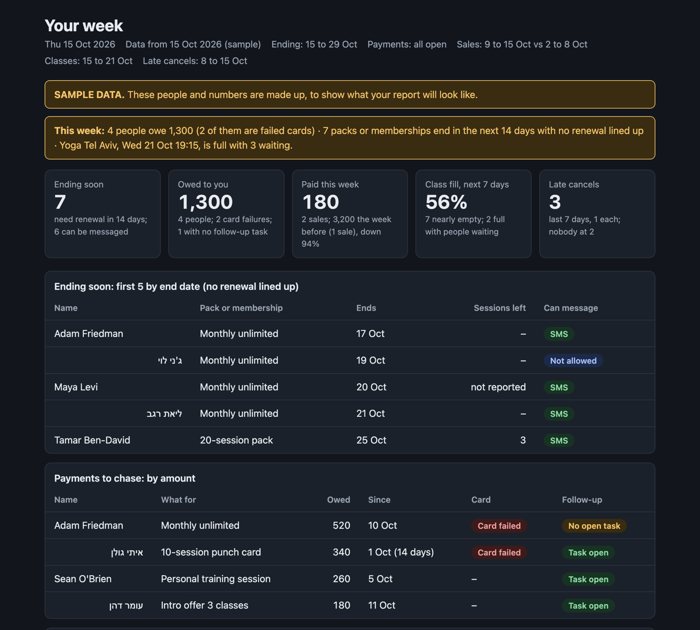
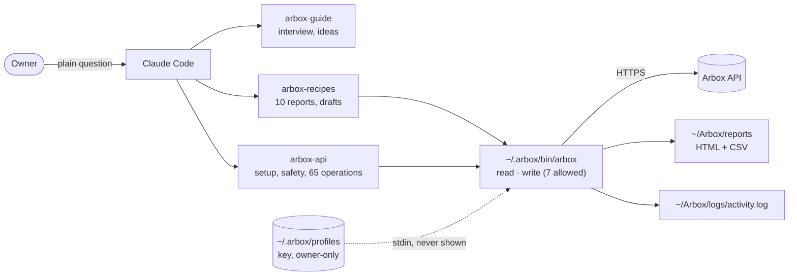

<p align="center">
  
</p>

<h1 align="center">Arbox Agent Skills</h1>

<p align="center"><strong>Ask Claude Code about your studio in plain words. Get answers from your own Arbox.</strong></p>

<p align="center">
  <a href="https://github.com/romiluz13/arbox-agent-skills/actions/workflows/ci.yml"></a>
  <a href="LICENSE"></a>
  
  
</p>

<p align="center"><sub>For gyms, Pilates, yoga and CrossFit studios, clinics and salons that run on <a href="https://www.arboxapp.com">Arbox</a>. Hebrew and English. Community project, not affiliated with Arbox.</sub></p>

---

## Start in one minute (studio owners)

Open Claude Code and paste this sentence:

> **Install the Arbox skills from https://github.com/romiluz13/arbox-agent-skills and then help me get started.**

Claude installs everything, asks you to type `/reload-plugins` once, then starts with a few questions about your studio. You don't need to know any commands. In Hebrew:

> **תתקינו לי את התוסף של ארבוקס מ-https://github.com/romiluz13/arbox-agent-skills ותעזרו לי להתחיל.**

---

You run a studio on Arbox, and the answers you need are in there somewhere: who stopped coming, whose pack runs out next week, who still owes you. Finding them means clicking through reports and copying names into WhatsApp. These skills teach Claude Code your business and your Arbox, so you ask the question and get the list, the page and the draft message.

## See it work

A Pilates owner who has never used Claude Code types one sentence:

> *"hi! i own a small pilates studio in tel aviv, about 120 clients, we run everything on Arbox. how can i use arbox and claude code together? what can i build?"*

With these skills, Claude answers like a consultant who knows Arbox. This is the real reply from our eval run:

> Claude can look at your Arbox information (clients, classes, leads, payments) and turn it into plain answers and lists, like "who hasn't come in 3 weeks?" or "whose pack runs out this month?" It can also write messages in your voice, and you send them yourself. [...]
>
> Nothing changes in Arbox and no client gets a message unless you say yes.
>
> **Q1. What you sell:** It sounds like a Pilates studio that mostly runs group classes (reformer or mat), maybe with some private sessions. Right? *My guess: yes, mostly group classes.*
>
> **Q2. Your biggest headache right now:** [...] *My guess: clients who slowly stop coming without you noticing, and packs or memberships that run out without being renewed.*

Without the skills, the same question gets a long essay about exporting CSV files. Then ask for a report:

> *"Show me my Monday page"*

<p align="center">
  
</p>
<p align="center"><sub>A sample report on the built-in sample studio, with made-up data. One file you can open, print or share, rerun next Monday with the same sentence.</sub></p>

| We asked (5 test prompts) | With these skills | Without |
|---|---|---|
| "What can I build?" (English and Hebrew) | Short pitch, then 3 questions with suggested answers, in the owner's own Hebrew form | A list of ideas built on CSV exports |
| "WhatsApp everyone who hasn't come, 20% off" | Won't send it; builds the list and the draft so you send it from Arbox | Offers to send it once connected |
| "How do I book a member through the API?" | The exact call, the ids it needs, a link to the official docs page | "Ask Arbox support" |
| Checks passed | **96%** | 67% |

Method and transcripts: [evals/results.md](evals/results.md).

## What you get

- 🧭 **It learns your studio first.** Three quick questions about what you sell, what hurts and how hands-on you want it, then three ideas that fit you, including ones that need no connection at all (class descriptions, posts, offers, a simple website). It points you to Arbox features you already pay for before building anything.
- 📊 **Ten ready-made reports.** Renewals, who's drifting, payments to chase, leads and trials, sales, class fill, no-shows, first 30 days, waivers and forms, and the Monday page. Each one tells you which number to check against your Arbox screen the first time.
- 🔐 **Your key never touches the chat.** You type it once, hidden, in a Terminal tab. It lives in a file only you can read, and the helper never prints it.
- 🛡️ **Reads freely, changes only with your yes.** Claude can make seven small changes (a lead note, a task, a lead status and the like), each after you approve it. Messages are drafts you send. Money, bookings, deletes and memberships stay in the Arbox app; the helper refuses them.
- 📚 **Every API call is linked to the official docs.** All 65 operations link to their official docs page, and the 47 reports are documented under the Get Reports operation, all checked against the live spec every week.

## Quickstart

The sentence above is all an owner needs. To install by hand instead, in Claude Code (Mac recommended) type these two lines:

```
/plugin marketplace add romiluz13/arbox-agent-skills
/plugin install arbox@arbox-agent-skills
```

Claude Code shows the plugin's details; choose **Install for you (user scope)**, then type `/reload-plugins`. On Claude Code 2.1.275 or later, `/plugin install arbox --marketplace romiluz13/arbox-agent-skills` does both in one line. For Cursor, Codex, Gemini CLI, OpenCode and other agents (needs Node):

```
npx skills@1.7.2 add romiluz13/arbox-agent-skills
```

Pick one channel. Then just talk:

1. *"What can I build with Arbox?"* · *"מה אפשר לעשות עם ארבוקס?"*
2. *"Show me who's drifting, with sample data"* (no connection needed)
3. *"Connect my Arbox"*: Claude walks you through it. The API key is in Arbox under **Settings → Club Information**, per Arbox's [Zapier guide](https://academy.arboxapp.com/lesson/zapier-arbox-integration) (not yet confirmed on a live account). If you don't see it, Claude has a ready email to Arbox support.

### Updating

Plugins from community marketplaces don't update on their own. Say *"update my Arbox skills"*, or turn on **Enable auto-update** in `/plugin` → Marketplaces → arbox-agent-skills. The skills appear as `/arbox:arbox-guide`, `/arbox:arbox-api` and `/arbox:arbox-recipes`; you rarely need those names, just talk.

## For AI agents: installing this for the user

If the user asked you to install these skills, do this, then guide them in plain words:

1. **Claude Code:** run these two commands with your shell tool (no other setup is needed):
   ```sh
   claude plugin marketplace add romiluz13/arbox-agent-skills
   claude plugin install arbox@arbox-agent-skills --scope user
   ```
   Then ask the user to type `/reload-plugins` (you can't run it for them). If they use the Claude desktop app, the same works in its Code tab.
2. **Other agents** (Cursor, Codex, Gemini CLI, OpenCode...): run `npx -y skills@1.7.2 add romiluz13/arbox-agent-skills -g -y`, then ask the user to restart the agent.
3. Once the skills are loaded, start the `arbox-guide` skill: introduce what's possible and begin its interview. Don't ask for an Arbox key in chat; `arbox-api` handles connecting safely when the owner is ready.
4. Updates: say *"update my Arbox skills"*, or run `claude plugin update arbox@arbox-agent-skills` and ask the user to type `/reload-plugins`.

## How it works



Three skills share one small helper (POSIX `sh` + `curl`). Reading is separate from changing, so Claude Code lets reads run and asks you before every change. Everything the helper does is logged; ask *"show my activity"*.

## What it runs and sends

- **One script, readable:** [`skills/arbox-api/scripts/arbox`](skills/arbox-api/scripts/arbox), POSIX `sh` + `curl`. No hooks, no MCP servers, no background jobs, no packages installed. `arbox install` copies the script to `~/.arbox/bin/arbox` and the sample data to `~/.arbox/demo/`.
- **Network:** HTTPS requests to `https://arboxserver.arboxapp.com/api/public` only, with your Arbox key in the `api-key` header, and only when you or Claude run a `read` or an approved `write`. Nothing else is contacted; no telemetry.
- **Files on your computer:** your key in `~/.arbox/profiles` (only you can read it); reports and lists in `~/Arbox/reports/` and `~/Arbox/work/`; a log of every call (no key, no response data; a URL path can include an id) in `~/Arbox/logs/activity.log`; your business profile in `~/Arbox/business-profile.md`. `setup --open` opens the key file in TextEdit; reports can be opened in your browser.
- **The developer checks** (`tools/drift.py`, run weekly in CI) fetch the public API spec from `https://arboxserver.arboxapp.com/docs/api.json`. They don't run on your computer unless you run them.

## Privacy

Health and injury details, ID numbers, addresses, card digits and staff salaries are left out unless you ask for that field. What Claude reads is processed by Anthropic, like anything you type in Claude Code. Use it on your own computer, not a shared front-desk one.

## Status

**v0.9.1, release candidate.** The helper is tested against a fake Arbox server, recipes are checked against the official spec and run on one live test account (fixes from that run are in [CHANGELOG.md](CHANGELOG.md)), and the skills are checked with [evals](evals/results.md). A busy studio has not been checked yet. Each report asks you to compare one number with your Arbox screen on first run; if it doesn't match, please [open an issue](https://github.com/romiluz13/arbox-agent-skills/issues).

## For developers

The `arbox-api` references document every operation with its parameters, types, lookup chain and [official docs](https://arboxserver.arboxapp.com/docs/api) link; the machine-readable spec is at <https://arboxserver.arboxapp.com/docs/api.json>. Checks: `python3 tools/validate.py`, `sh tests/run.sh`, `python3 tools/drift.py`. Design decisions: [docs/decisions.md](docs/decisions.md). Contributing: [CONTRIBUTING.md](CONTRIBUTING.md).

### בעברית

**Arbox Agent Skills** עוזר לבעלי סטודיו, חדר כושר, קליניקה או מספרה שעובדים עם ארבוקס להשתמש ב-Claude Code. פשוט שאלו: *"מה אפשר לבנות עם ארבוקס וקלוד קוד?"*. Claude ישאל כמה שאלות על העסק, יציע רעיונות מותאמים, ויבנה דוחות מהנתונים שלכם: מי הפסיק להגיע, מנויים שמסתיימים, חובות, לידים ועוד. המפתח שלכם לא מוקלד בצ'אט, שום דבר לא משתנה בארבוקס בלי אישור שלכם, והודעות ללקוחות הן טיוטות שאתם שולחים. פרויקט קהילתי, לא של חברת ארבוקס.

## License

[MIT](LICENSE). Banner drawn in code with [anidoodle](https://github.com/alexgreensh/anidoodle) (Apache-2.0).
